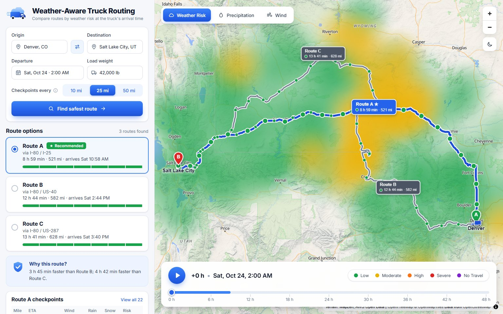
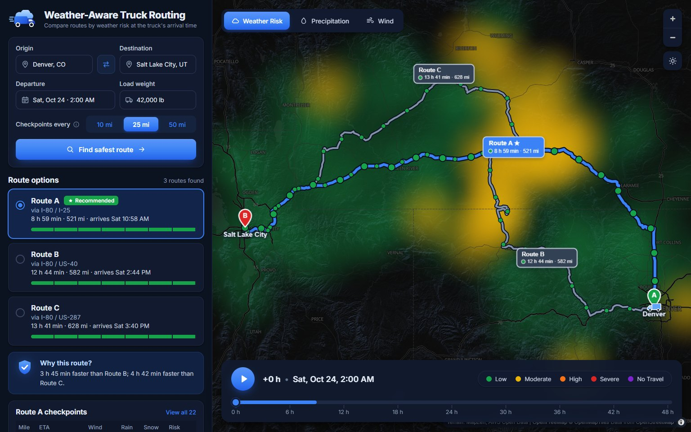
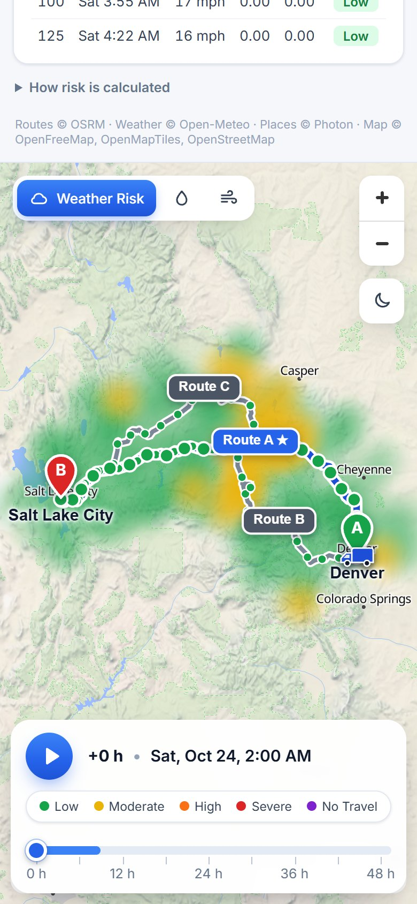
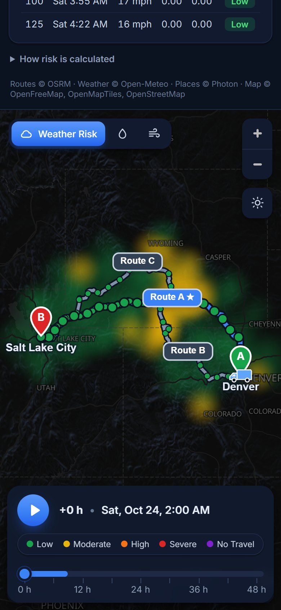

# Weather-Aware Truck Routing

A React + Django app that helps a truck driver pick the safest of three routes. It forecasts the weather each route will meet **at the time the truck gets there**, scores it with the brief's risk and load rules, and recommends a route.

**Live demo:** https://weather-truck-routing-dawood.vercel.app  ·  **Walkthrough:** _Loom link_



  

## Requirements coverage

Every line of the brief, where it is implemented, and how it is checked.

| Brief | How it is met | Checked by |
|---|---|---|
| React + Django web app | React 19 + TypeScript (Vite, MapLibre) frontend; Django 5 + DRF API | — |
| User enters origin & destination | Place search with suggestions (Photon/OpenStreetMap), keyboard support, swap button | `test_geocode_*` |
| User enters departure date/time | Date-time picker; the API rejects times over 1 h in the past or beyond the 13-day forecast | `test_validation_errors` |
| User enters load weight | Pounds, 0–200,000; drives the load rules | `test_validation_errors`, `test_risk` |
| Generate 3 route options using a routing API | OSRM alternatives, then forced detours either side of the fastest route; a relaxed second pass when the road network leaves only near-duplicates | `test_plan_returns_three_routes…`, `test_a_third_route_is_found…` |
| Sample weather every 10 / 25 / 50 miles at the truck's ETA | A checkpoint every N miles (plus the destination); each gets its own forecast lookup, interpolated to the truck's ETA there | `test_planner`, `test_interval_changes_checkpoint_density`, `test_typical_trips_get_one_weather_lookup_per_checkpoint` |
| Calculate risk with the risk/load rules | `domain/risk.py`, a direct transcription of both tables | `test_risk` (every threshold edge and load rule) |
| Recommend the best route (Severe miles → High miles → average risk → travel time) | Sort key in `domain/planner.py`, with a plain-English reason and the time trade-off | `test_recommendation_order_follows_the_brief`, `test_ties_fall_through_to_travel_time`, `test_no_travel_outranks_everything` |
| Show all routes, checkpoints, risk levels, ETAs and route summaries on a map | All three routes; every route's checkpoints coloured by risk (hover or click for ETA and per-factor risk); route tags with time, distance and worst risk; trucks at the selected time | Screenshots above |
| Weather heatmap along the trip corridor with a 0–48 h forecast slider | Forecast points along and ±30/±60 mi either side of every route, 49 hourly frames (+0 to +48 h), a timeline with smooth playback | `test_corridor`, `test_plan_returns_three_routes…` (49 frames) |
| Third-party APIs allowed | OSRM (routing), Photon (geocoding), Open-Meteo (weather), OpenFreeMap (tiles) | — |
| Deliverables | GitHub repo, hosted app (link above), Loom walkthrough | — |

## What it does

- **Input:** origin and destination (with place search), departure date/time, load weight, and a checkpoint interval of 10, 25 or 50 miles.
- **Three route options** from a routing API. If the provider returns fewer than three, detours are forced through points either side of the fastest route; where the road network truly has fewer distinct roads, the UI says so.
- **Weather checkpoints** every 10/25/50 miles, plus origin and destination. Each one gets its own forecast lookup, with the hourly forecast **interpolated to the truck's ETA** at that point.
- **Risk** per checkpoint from the wind/rain/snow thresholds and the load rules, with the factor that drove it ("wind 47 mph with 42,000 lb load").
- **Recommendation**, ranked by the brief's priorities, with a plain-English reason ("Fewer Severe miles than Route B (0 vs 25 mi)"). When the safest route is not the fastest, the reason states the cost ("It takes 3 h 47 min longer than Route A, the fastest option").
- **Map:** all routes on a terrain basemap, every route's checkpoints in their risk colour (hover for ETA and per-factor risk, click to pin), route tags with time, distance and worst risk, and a **weather-risk heatmap along the trip corridor** with a **0–48 h forecast timeline**. A **Weather Risk / Precipitation / Wind** switch shows overall risk or a single factor. Truck markers show where each truck is at the selected time, and a band on the timeline marks when the selected truck is on the road.
- **Smooth playback.** Play runs on animation frames: the trucks glide along their routes, the timeline moves continuously, and the weather field cross-fades between hourly frames. Dragging the timeline does the same; arrow keys step whole hours. With the OS "reduce motion" setting it steps hour by hour.
- **Light and dark themes.** The app follows the device setting, and a toggle under the map's zoom buttons overrides it (remembered in the browser). The map swaps to a dark basemap without losing the plan, layer or camera. The layout works on phones too.
- The default trip (Denver → Salt Lake City, across the windy I-80 corridor in Wyoming) is planned on arrival, so the first screen already shows results.

## How the logic works

| Step | Detail |
|---|---|
| Routes | OSRM (`/route/v1/driving`, `alternatives=3`), then up to 8 forced detours. Near-duplicates (more than 85% of map cells shared) and routes over 1.6 times the shortest are dropped; if that leaves fewer than three, one relaxed pass (97%, 2×) runs so a usable third option still appears. Unroutable trips (an island, a point far from roads) get a clear 422 message. |
| Truck travel time | OSRM's per-segment durations, **capped at 65 mph** so car-speed estimates don't make truck ETAs optimistic. |
| Checkpoints | Every N miles along the polyline, plus the destination. ETA = departure + cumulative truck time at that distance. |
| Weather | Open-Meteo hourly `wind_speed_10m` (mph), `rain` and `snowfall` (in/hr), linearly interpolated to each ETA. Each checkpoint is looked up at its own location (0.05° grid, about 3 mi); all checkpoints of all routes go out in a few batched requests. |
| Risk | Overall risk is the worst of wind (after load rules), rain and snow; see the table below. |
| Risk miles | Each checkpoint stands for the road nearer to it than to its neighbours, so the miles by level add up exactly to the route length. |
| Recommendation | Lexicographic: **No Travel miles → Severe miles → High miles → average risk (mile-weighted, 0–4) → travel time**. Miles are compared at 0.1 mi and average risk at 0.01, so rounding noise can't decide the winner. |
| Heatmap | Up to 180 points along every route, at the centre line and ±30/±60 mi either side. Forecasts from the departure hour to +48 h (49 hourly frames) are scored with the same rules per point per hour, overall and per factor (wind after the load rules; the worse of rain and snow). Each point is drawn as a soft disc in its own risk colour; see the note below on why this isn't a density heatmap. The frontend pre-builds one frame per hour; two copies of the layer cross-fade between the hours either side of the selected time, so playback only changes opacities on the GPU. |

### Risk rules (from the brief)

| Condition | Low | Moderate | High | Severe | No Travel |
|---|---|---|---|---|---|
| Wind | < 25 mph | 25–34 | 35–44 | 45–54 | ≥ 55 mph |
| Rain | < 0.10 in/hr | 0.10–0.25 | 0.25–0.50 | 0.50–1.00 | > 1.00 |
| Snow | < 0.5 in/hr | 0.5–1.0 | 1.0–2.0 | 2.0–3.0 | > 3.0 |

Load rules: wind ≥ 55 mph is No Travel for any load; 45–54 mph with > 30,000 lb is No Travel; 35–44 mph with > 40,000 lb is Severe.

### Assumptions and interpretations

- **Shared range edges** (for example rain at exactly 0.25 in/hr) go to the **higher** level. It's a safety rule, so the conservative reading wins. "No Travel" applies strictly above 1.00 in/hr of rain and 3.0 in/hr of snow, as written.
- **No Travel outranks Severe** in the recommendation, although the brief's list starts at Severe.
- The **heatmap's 0–48 h window starts at the departure hour**, because that is the window the trip actually uses. The shaded band on the slider marks when the selected truck is on the road.
- Wind is the **sustained 10 m wind speed**, not gusts.
- Forecasts reach about 15 days ahead, so departures are limited to the next 13 days.

### Why the heatmap is drawn as risk-coloured discs

A classic density heatmap (MapLibre's `heatmap` layer) colours by *how much weight piles up*, so a dense cluster of Low points can turn yellow and look like Moderate. That misleads on a safety map. Here each forecast point is a blurred circle whose colour is exactly its rule-based level, sized from the sampling spacing so neighbours blend into a continuous field. Higher levels are drawn on top (`circle-sort-key`). The result looks like a heatmap, but the colour always means the brief's level.

### Staying inside free API limits

Open-Meteo's free tier allows 600 calls a minute and counts every location as a call, so the weather client is built around a budget:

- Forecasts are cached **per location** for 20 minutes, with coordinates snapped to a 0.05° grid (about 3 mi, finer than the weather models). Re-planning with another load or interval, or another trip through the same area, reuses them.
- A plan uses at most 450 locations. Checkpoints come first: each gets its own lookup, up to 360. The corridor heatmap gets the rest (80–180 points). For example, Chicago → Denver at 10-mile spacing (327 checkpoints) still samples each checkpoint on its own. Only coast-to-coast trips at 10-mile spacing go over, and then neighbouring checkpoints share a coarser grid cell; ETAs and risk are still computed per checkpoint.
- If the weather API throttles, the API returns **503 with `Retry-After: 60`** and a clear message instead of hanging; an outage returns 502. If only the heatmap fails, the routes and recommendation are still returned.
- The frontend gives up after 70 s (the serverless limit is 60 s) with a readable message.

All rules live in [`backend/routing/domain/risk.py`](backend/routing/domain/risk.py) and are covered boundary by boundary in [`tests/test_risk.py`](backend/tests/test_risk.py).

## Architecture

```
frontend/  React 19 + TypeScript + Vite, MapLibre GL (WebGL map and heatmap), no UI library
  App.tsx                   state: plan, selected route, layer, theme
  timeline.ts               forecast time shared by the slider and the map (updates per frame without re-rendering the app)
  components/MapView.tsx    one map instance; sources updated with setData, never re-created
  components/TripForm.tsx   inputs, place search, 10/25/50 mi interval
  components/RouteCards.tsx summaries, risk-mile bars, recommendation reason
  components/ForecastSlider.tsx 0–48 h timeline, play/pause, trip window, legend
  components/LayerSwitch.tsx  overall / precipitation / wind risk layers
backend/   Django 5 + DRF, stateless (no database)
  routing/domain/           pure logic: risk rules, geometry, planner, corridor sampling
  routing/clients/          OSRM, Open-Meteo and Photon clients (retries, caching)
  routing/services.py       orchestration: routes → checkpoints → forecasts → evaluation
  routing/views.py          /api/plan, /api/geocode, /api/health
api/index.py               Vercel serverless entry point for the Django app
```

The domain layer is free of I/O, so the rules and ranking are unit-tested without the network. The API tests fake OSRM and Open-Meteo with `responses`.

### API

`POST /api/plan`

```json
{
  "origin": {"lat": 41.8781, "lon": -87.6298, "label": "Chicago"},
  "destination": {"lat": 39.7392, "lon": -104.9903, "label": "Denver"},
  "departure": "2026-10-24T14:00:00Z",
  "load_lbs": 42000,
  "interval_miles": 25
}
```

The response contains `routes[]` (geometry, per-vertex elapsed seconds, summary, miles by risk level, average and max risk, checkpoints with ETA, weather values and per-factor risk), `recommended_route_id`, `recommendation_reason`, and `heatmap` (`points`, plus `levels`, `wind_levels` and `precip_levels`, each `[hour][point]` for +0 to +48 h). Errors: 400 for invalid input (per field), 422 when no drivable route exists, 502 if a provider fails, 503 with `Retry-After` when one throttles.

`GET /api/geocode?q=denver` returns place suggestions.

## Running locally

Requires Python 3.10+ and Node 20+. No API keys are needed: OSRM, Open-Meteo, Photon, OpenFreeMap tiles and the AWS open terrain tiles are all free.

```bash
# Backend
cd backend
python -m venv .venv && .venv/Scripts/activate   # macOS/Linux: source .venv/bin/activate
pip install -r requirements-dev.txt
python manage.py runserver            # http://127.0.0.1:8000

# Frontend (second terminal)
cd frontend
npm install
npm run dev                           # http://localhost:5173, /api is proxied to Django
```

Tests: `cd backend && pytest` (71 tests: every threshold boundary and load rule, the ranking and its explanation, mile attribution, corridor sampling, route naming, the three-route guarantee, per-checkpoint weather lookups, place search, and the API with OSRM and Open-Meteo faked, including unroutable, outage, rate-limit and partial-failure paths).

### Configuration

| Variable | Default | Purpose |
|---|---|---|
| `DJANGO_DEBUG` | `1` (`0` on Vercel) | Debug mode |
| `DJANGO_SECRET_KEY` | dev key | Set in production |
| `OSRM_URL` | public OSRM demo | Point at a self-hosted OSRM (or a truck profile) |
| `OPEN_METEO_URL`, `PHOTON_URL` | public endpoints | Swap providers |
| `CORS_ALLOWED_ORIGINS` | Vite dev origin | Needed only if the frontend is hosted separately |

## Deployment

One Vercel project: Vite builds the static frontend, and `api/index.py` runs Django as a Python serverless function behind `/api/*` (see `vercel.json`). It's same-origin, so no CORS setup is needed.

## Trade-offs and next steps

- The public OSRM server uses a **car** profile. A self-hosted OSRM or OpenRouteService `driving-hgv` profile would add truck restrictions (height, weight, hazmat). `OSRM_URL` makes the swap a config change.
- The cache is in-process (LocMem). Redis would share it across serverless instances, and a paid or self-hosted Open-Meteo (`OPEN_METEO_URL`) would remove the free-tier budget.
- Possible additions: gust-aware wind risk, alerts from NWS, and a departure-time optimiser ("leave 3 h later to avoid the storm").
